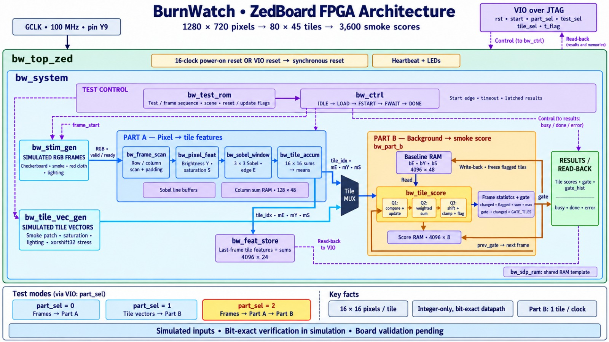

# BurnWatch

An FPGA-accelerated open-burning smoke detector. A PYNQ-Z2 scores every frame of a CCTV feed, and AWS checks each suspect frame and sends an alert.

> Work in progress. Every section below is filled in during the build.

## Problem
_To be written from the sourced figures in `docs/sources.md`._

## What BurnWatch does
_To be written: detect, verify, alert, keep video private._

## Architecture
_System figure (`docs/architecture.svg`: camera → PYNQ → AWS) goes here._

### FPGA datapath (ZedBoard test build)

The PL turns one 1280×720 frame into 80×45 tiles of 16×16 px and gives each tile a smoke score, 3,600 scores per frame. The datapath is integer-only and written to match `detector/golden.py` bit for bit.

- **Part A, pixels to tile features.** `bw_frame_scan` walks the frame row by row with border padding. `bw_pixel_feat` computes luma Y and saturation S per pixel, `bw_sobel_window` runs a 3×3 Sobel on Y (with line buffers) to get edge strength E, and `bw_tile_accum` sums each 16×16 tile in a 128×48 column-sum RAM and outputs the tile means mE, mY and mS.
- **Part B, background to smoke score.** `bw_part_b` keeps a per-tile baseline (bE, bY, bS) in a 4096×48 RAM. `bw_tile_score` is a three-stage pipeline (compare and update, weighted sum, shift, clamp and flag) that handles one tile per clock and writes an 8-bit score per tile. Frame statistics count changed and flagged tiles, sum and max, and set the gate when more than `GATE_TILES` tiles changed. A gated frame freezes flagged tiles in the baseline write-back.
- **Test control.** `bw_test_rom` holds frame sequences (scene, reset and update flags), and `bw_ctrl` steps through IDLE → LOAD → FSTART → FWAIT → DONE with a start edge, a timeout and latched results. `bw_stim_gen` makes simulated RGB frames (checkerboard, smoke, red cloth, lighting changes), and `bw_tile_vec_gen` makes simulated tile vectors (smoke patch, saturation, lighting, xorshift32 stress) that feed Part B directly through the tile mux.
- **Read-back.** Tile scores, gate, gate history and busy/done/error flags, plus `bw_feat_store` (last frame's tile features), are read over JTAG through a VIO, which also drives reset, start, `part_sel`, `test_sel`, `tile_sel` and `t_flag`.

| `part_sel` | Path under test |
|---|---|
| 0 | Simulated frames → Part A |
| 1 | Simulated tile vectors → Part B |
| 2 | Simulated frames → Part A → Part B (full chain) |

**Status:** the inputs are simulated and bit-exact checking has been done in simulation. Board validation is still pending.

## PL/PS split
_What runs in the FPGA fabric and what runs on the ARM, with resource use from the synthesis report._

## AWS
_Each service, what it does here, and an example event and verdict._

## Results
_Measured throughput and the clip test table, from `docs/results.md`._

## Limitations
_What we observed and what we do not claim._

## How to run
_Laptop, AWS, PYNQ and HLS/Vivado steps, with exact commands._

## Credits and licences
This project is MIT-licensed (see [LICENSE](LICENSE)). It builds on:

- [Xilinx PYNQ](https://github.com/Xilinx/PYNQ) (BSD-3-Clause)
- [paho-mqtt](https://github.com/eclipse-paho/paho.mqtt.python) (EPL-2.0 / EDL-1.0)
- [boto3](https://github.com/boto/boto3) (Apache-2.0)
- [anthropic Python SDK](https://github.com/anthropics/anthropic-sdk-python) (MIT)
- [NumPy](https://numpy.org/) (BSD-3-Clause)
- [OpenCV](https://opencv.org/) (Apache-2.0)
- [AWS SAM CLI](https://github.com/aws/aws-sam-cli) (Apache-2.0)

## Built the project from October 8 to 11, 2026, for Environmental Hacks 2026.
