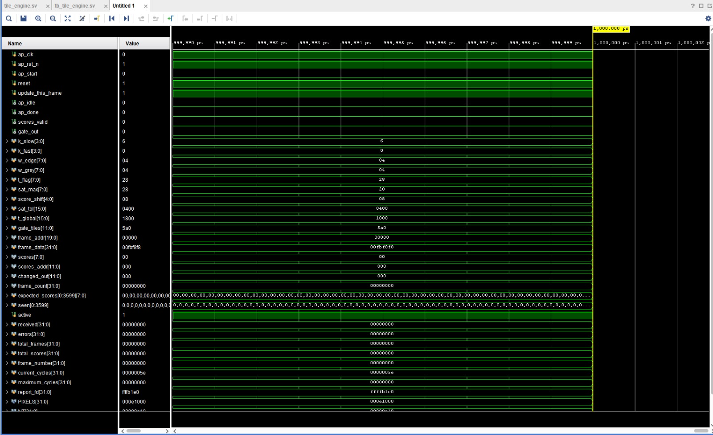
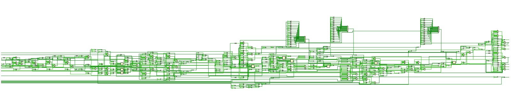
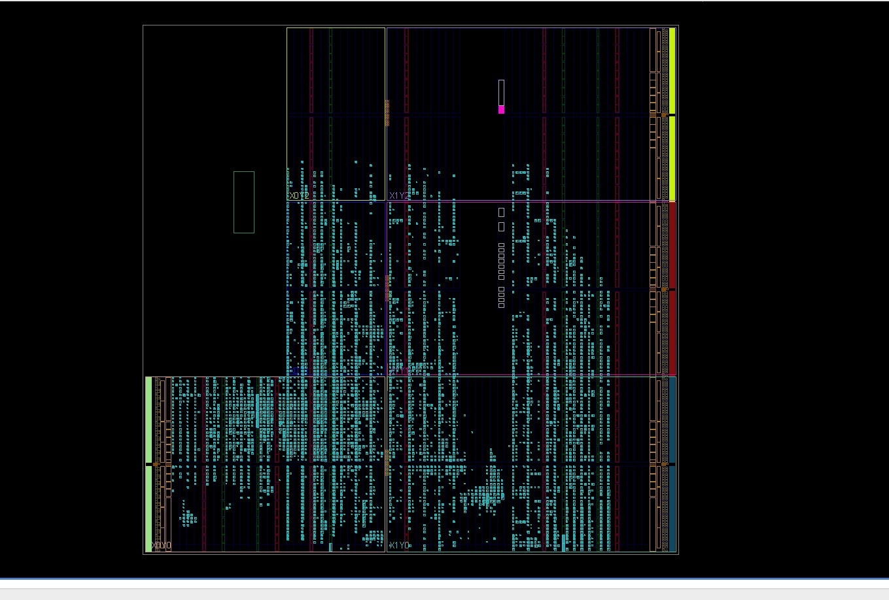

# BurnWatch

**BurnWatch is an FPGA-oriented open-burning smoke detector prototype.** Its integer reference model and standalone RTL scoring core turn a 1280×720 RGB frame into a 45×80 grid of 3,600 tile scores. The current repository validates the detector datapath in simulation and contains camera/HDMI and AWS provisioning utilities. The ARM event runtime, cloud verifier and final PYNQ overlay are still separate follow-up work.

> **Status boundary:** this README distinguishes what is implemented and tested from what is planned. The checked-in RTL simulation is not a live PYNQ deployment and the current Lambda is intentionally a stub.

## Problem and users

Open burning of garbage, leaves, waste and biomass is prohibited in Delhi. Current CAQM GRAP guidance requires strict enforcement of the prohibition, vigilance at landfill/dumpsite locations, and reporting through the 311, Green Delhi and SAMEER apps. See [`research_notes/BurnWatch citable sources/delhi_policy_and_data.md`](research_notes/BurnWatch%20citable%20sources/delhi_policy_and_data.md) for the source register.

The defensible product goal is not to claim a regulatory air-quality measurement. It is to provide a **local visual event signal and evidence frame** that can support an existing human reporting/enforcement workflow:

```text
camera sees a suspected burn
→ edge hardware scores the scene
→ a future ARM runtime tracks the region
→ a future cloud verifier checks one suspect frame
→ a human receives evidence and decides what to report
```

## Current implementation status

| Area | Current state |
|---|---|
| Python integer reference | Implemented in `detector/golden.py`; covered by synthetic tests |
| Shared formats | Implemented in `tools/contracts.py` and documented in `docs/contracts.md` |
| Golden-vector generation | Implemented in `tools/dump_golden.py` |
| HLS header generation | Implemented in `tools/gen_header.py` |
| Laptop camera/clip feed | Implemented in `tools/camfeed.py` |
| PYNQ HDMI input check | Implemented in `device/hdmi_check.py` |
| Standalone SystemVerilog scoring core | Implemented in `overlays/rtl_sim/` |
| RTL simulation | Checked-in pass: 80 frames, 288,000 tile scores, zero mismatches |
| Native synthesis | Completed, but timing and package-I/O limits are not met |
| OOC placement/routing | Completed for the isolated core, but 100 MHz timing fails |
| ZedBoard + VIO package | Implemented as a separate simulated-input/hardware package; board run remains unverified in this checkout |
| ARM region/state runtime | Not implemented in this checkout |
| Device MQTT/S3/offline queue runtime | Not implemented in this checkout |
| Lambda verifier | Stub only; raises `NotImplementedError` intentionally |
| Final PYNQ `.bit`/`.hwh` overlay | Not present |

## Architecture



Mermaid source: [`docs/architecture.mmd`](docs/architecture.mmd).

The intended full system has five boundaries:

1. **Input:** `tools/camfeed.py` displays a camera or clip at 1280×720 for HDMI capture.
2. **Edge scoring:** the Python golden model and standalone RTL compute tile-level visual features and scores.
3. **Runtime decision:** an ARM-side region tracker/state machine is planned but not currently checked in.
4. **Cloud evidence path:** AWS provisioning and SAM infrastructure exist, but the device uploader and verifier are not complete.
5. **Separate ZedBoard package:** `zedboard/burnwatch_zed_vio/` drives the RTL with on-chip synthetic scenes and VIO; it does not use the Zynq PS or a camera.

## FPGA datapath



Mermaid source: [`docs/fpga_datapath.mmd`](docs/fpga_datapath.mmd).

The scoring algorithm is specified by [`detector/golden.py`](detector/golden.py):

- luma: `Y = (77R + 150G + 29B) >> 8`;
- saturation: `S = max(R,G,B) - min(R,G,B)`;
- 3×3 Sobel edge strength `E` on luma;
- 16×16 tile means for edge, luma and saturation;
- Q8 per-tile background baselines;
- edge-drop and grey-shift score terms;
- saturation rejection for colourful changes;
- global-change gate for lighting/exposure/camera changes;
- baseline freeze for flagged tiles and `K_FAST = 0` snap re-baselining after a gated frame.

The source-level geometry is:

```text
1280 × 720 pixels
16 × 16 pixels/tile
80 × 45 tiles
3,600 scores/frame
```

The RTL datapath in `overlays/rtl_sim/tile_engine.sv` uses rotating luma line buffers, tile accumulators, persistent baselines and a score stream. Its ports are a **private simulation harness**, not the AXI-Lite/m_axi interface described in the future HLS contract.

### ZedBoard/VIO hardware package

The hand-written Verilog package in [`zedboard/burnwatch_zed_vio`](zedboard/burnwatch_zed_vio) is a separate experiment targeting `xc7z020clg484-1`:

- Part A: simulated RGB frames → pixel features → tile means;
- Part B: simulated tile vectors → score/baseline engine;
- integrated path: simulated frame → Part A → Part B;
- VIO controls reset, start, test selection, tile selection and `T_FLAG`;
- VIO reads status, statistics and one tile’s feature/score/baseline values.

It deliberately does not implement camera capture, HDMI, ARM software, MQTT, S3 or cloud verification.

Attached FPGA evidence is included here:

| Image | Meaning |
|---|---|
|  | RTL simulation waveform showing control, parameter, score and state signals |
|  | Synthesized RTL datapath view |
|  | Device placement/resource view from the RTL project |
| [Existing FPGA architecture image](docs/fpga_architecture.jpg) | ZedBoard/VIO block-level architecture |

## PL/PS split and validation boundary

| Function | Current implementation | Evidence |
|---|---|---|
| Pixel feature extraction | SystemVerilog RTL and ZedBoard Verilog package | RTL simulation vectors |
| Tile scoring/baselines | SystemVerilog RTL and ZedBoard Verilog package | RTL simulation vectors |
| Python reference | NumPy integer implementation | `tests/test_golden.py` |
| ARM region grouping | Planned | No `detector/regions.py` in this checkout |
| ARM state machine | Planned | No `detector/state.py` in this checkout |
| PYNQ AXI driver | Planned | No `device/pl_engine.py` in this checkout |
| PYNQ final overlay | Planned | No `.bit`/`.hwh` pair in `overlays/` |

### Validation ladder



Mermaid source: [`docs/validation.mmd`](docs/validation.mmd).

The checked-in evidence is:

- RTL simulation: **PASS**, 80 full-resolution frames, 288,000 scores, zero mismatches;
- native synthesis: completed, but reports `-17.202 ns` worst setup slack and `206` required bonded I/O versus `125` available;
- OOC route: all internal routable nets completed, but reports `-20.092 ns` setup WNS and 52,834 failing endpoints;
- no final board bitstream, AXI/PS wrapper, physical board FPS or power measurement is claimed.

See [`overlays/rtl_sim/VALIDATION.md`](overlays/rtl_sim/VALIDATION.md), [`SYNTHESIS_VALIDATION.md`](overlays/rtl_sim/SYNTHESIS_VALIDATION.md) and [`OOC_VALIDATION.md`](overlays/rtl_sim/OOC_VALIDATION.md).

## AWS status

The repository contains AWS provisioning and infrastructure scaffolding, not a working verification pipeline yet.

| Component | Current state |
|---|---|
| IoT Core setup | `cloud/setup_iot.py` provisions a Thing, certificate, policy and local `.env` |
| Device S3 identity | `cloud/setup_device_iam.py` creates a narrowly scoped upload-only IAM user as a hackathon shortcut |
| MQTT smoke test | `cloud/mqtt_smoke_test.py` tests mutual-TLS publish/subscribe to `burnwatch/test` |
| SAM template | `cloud/template.yaml` defines S3, DynamoDB, SNS, Lambda, lifecycle and IAM wiring |
| Lambda verifier | `cloud/verify/app.py` is a deliberate P4 stub and raises `NotImplementedError` |
| Bedrock/Nemotron/Rekognition | Permissions/parameters are scaffolded; no verifier call is implemented yet |
| Device event/heartbeat upload | No `device/cloud.py` or `device/main.py` exists yet |
| Verdict return/viewer | No device verdict receiver or `tools/viewer.py` exists yet |

Never present the cloud path as end-to-end until the S3 trigger, verifier, DynamoDB row, alert and verdict have been tested together.

## Tests and reproducibility

### Python reference and contract tests

The checked-in validation record reports 24 tests passed across:

```powershell
python -m pytest tests/test_golden.py tests/test_contracts.py -q
```

That historical report is documented in [`overlays/rtl_sim/VALIDATION.md`](overlays/rtl_sim/VALIDATION.md). Re-run the command in an environment containing the laptop requirements before relying on it as a current result.

### Generate golden vectors and HLS constants

```powershell
python tools/dump_golden.py --synthetic
python tools/dump_golden.py --synthetic --update-every 3 --reset-at 0,30 --name synthetic-u3
python tools/gen_header.py
python tools/gen_header.py --check
```

Generated vectors are intentionally ignored by Git; see [`docs/contracts.md`](docs/contracts.md).

### Laptop camera feed

```powershell
python tools/camfeed.py --list
python tools/camfeed.py --camera 1 --monitor 2
python tools/camfeed.py --clip testdata/clips/example.mp4 --monitor 2
```

### PYNQ HDMI check

On the board, after the laptop is already outputting 1280×720 at 60 Hz:

```bash
cd ~/burnwatch
bash device/run.sh device/hdmi_check.py
```

This validates the standard PYNQ base overlay HDMI input and saves three diagnostic frames. It does not run the detector.

### RTL simulation

See [`overlays/rtl_sim/README.md`](overlays/rtl_sim/README.md) for vector generation, project installation and Vivado/XSim commands. The simulation checks every score, gate, changed count, frame count and persisted baseline state.

## Known limitations

- Smoke detection is a visual heuristic, not a regulatory-grade smoke or AQI measurement.
- The Python reference and RTL simulation use synthetic scenes; no field accuracy, false-positive rate or missed-detection rate is claimed.
- The standalone RTL core has no AXI/PS wrapper and has not produced a deployable PYNQ overlay.
- Synthesis and OOC timing do not meet the 100 MHz target.
- The current repository does not contain the ARM region/state runtime.
- The AWS Lambda verifier is a stub; S3 upload does not yet produce a verdict.
- The ZedBoard package uses simulated input and VIO, not a camera.
- The plan’s IAM user is a hackathon shortcut. Production should use short-lived device credentials.
- No automatic complaint is submitted; any future complaint text must remain a human-reviewed draft.

## Repository map

| Path | Purpose |
|---|---|
| `detector/` | Integer reference model and parameters |
| `tools/` | Camera feed, contract helpers and vector/header generation |
| `device/` | HDMI validation and PYNQ launcher; runtime is not yet implemented |
| `cloud/` | SAM template, IoT/IAM setup, MQTT smoke test and verifier stub |
| `overlays/rtl_sim/` | Standalone SystemVerilog simulation, synthesis and OOC evidence |
| `zedboard/burnwatch_zed_vio/` | Separate ZedBoard/VIO Verilog package |
| `docs/` | Contracts, diagrams, validation evidence and screenshots |
| `research_notes/` | Cited Delhi policy and source-apportionment notes |

## Credits and licences

This project is MIT-licensed (see [LICENSE](LICENSE)). It builds on:

- [Xilinx PYNQ](https://github.com/Xilinx/PYNQ) (BSD-3-Clause)
- [paho-mqtt](https://github.com/eclipse-paho/paho.mqtt.python) (EPL-2.0 / EDL-1.0)
- [boto3](https://github.com/boto/boto3) (Apache-2.0)
- [anthropic Python SDK](https://github.com/anthropics/anthropic-sdk-python) (MIT; planned verifier dependency)
- [NumPy](https://numpy.org/) (BSD-3-Clause)
- [OpenCV](https://opencv.org/) (Apache-2.0)
- [AWS SAM CLI](https://github.com/aws/aws-sam-cli) (Apache-2.0)

## Built 8–11 October 2026 for Environmental Hacks 2026
